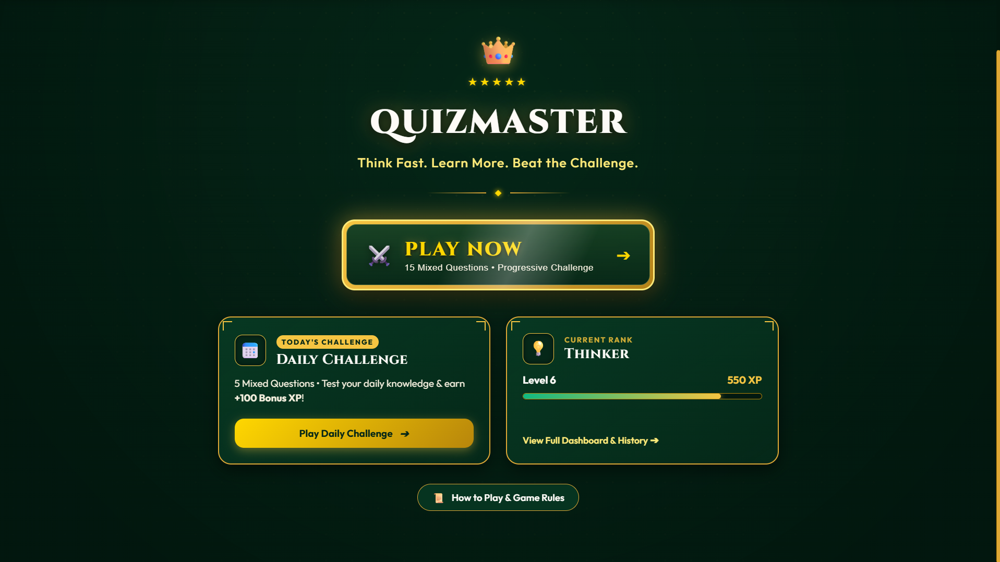
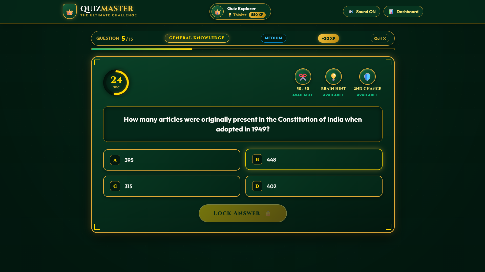
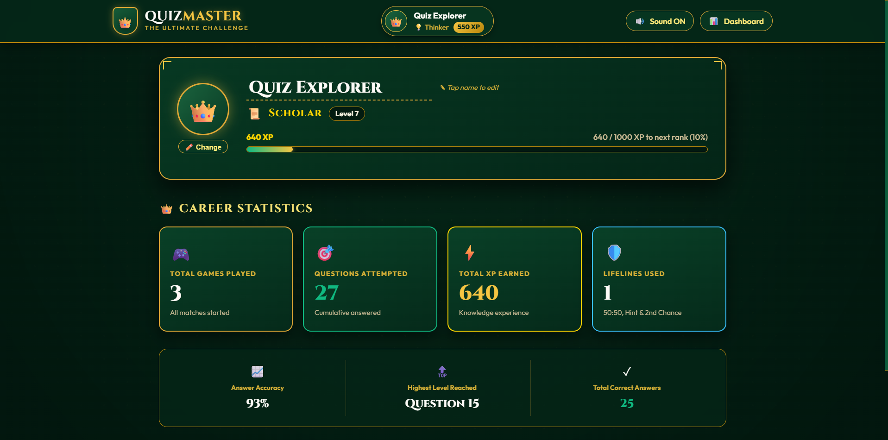
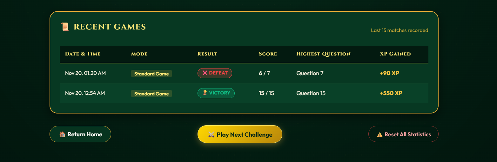

# 👑 QuizMaster – The Ultimate Knowledge Challenge

A fun and interactive quiz game built using HTML, CSS and JavaScript. Test your knowledge with randomly mixed questions from different topics and earn XP as you progress.

### ✨ Features
- 15 mixed-topic questions per game.
- 45-second timer for Questions 1–10.
- Unlimited time for Questions 11–15.
- Three lifelines: 50:50, Brain Hint and Second Chance.
- XP and ranking system.
- Player profile dashboard.
- Game statistics and recent game history.
- Daily Challenge.
- Detailed answer explanations.
- Responsive design.
- Local Storage support.

## 📸 Screenshots

### 🏠 Home Screen

### 🎮 Quiz Gameplay

### 👤 Player Dashboard

### 🏆 Game Results

### 🛠️ Technologies
- HTML5
- CSS3
- JavaScript
- Local Storage

### 🎨 Theme
Royal Emerald Green & Golden gaming interface.

### 🚀 Run Locally
1. Clone the repository.
2. Open the project folder.
3. Run `index.html` in your browser.

### 👨‍💻 Developer
**Anish Kumar Gupta**

⭐ Challenge Your Mind. Expand Your Knowledge!